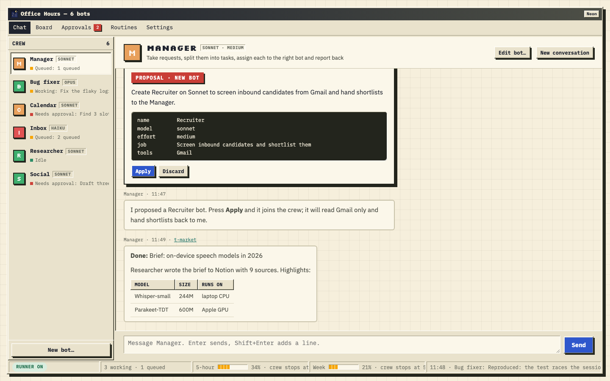
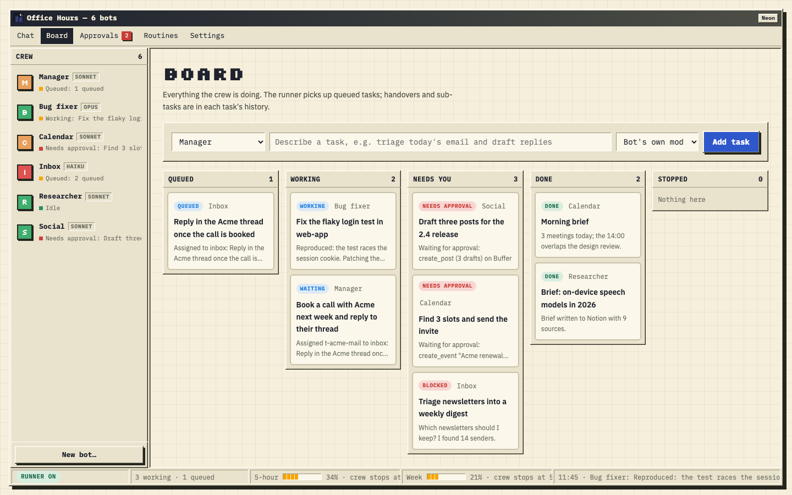
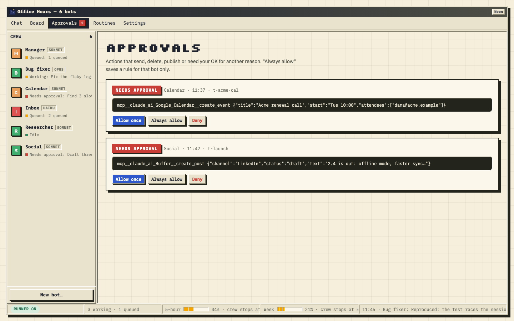
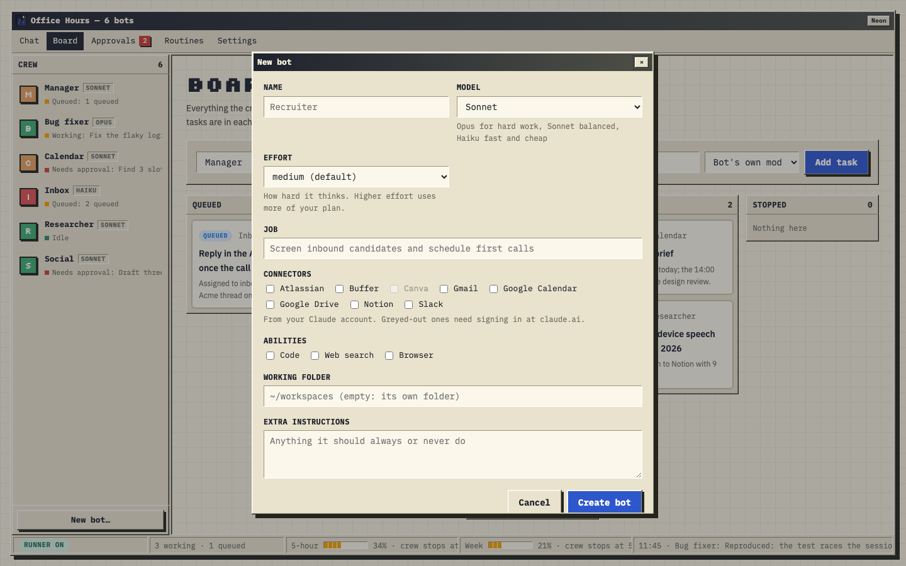
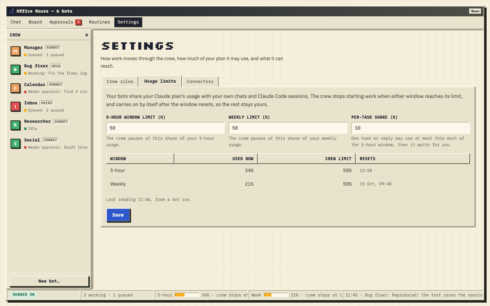
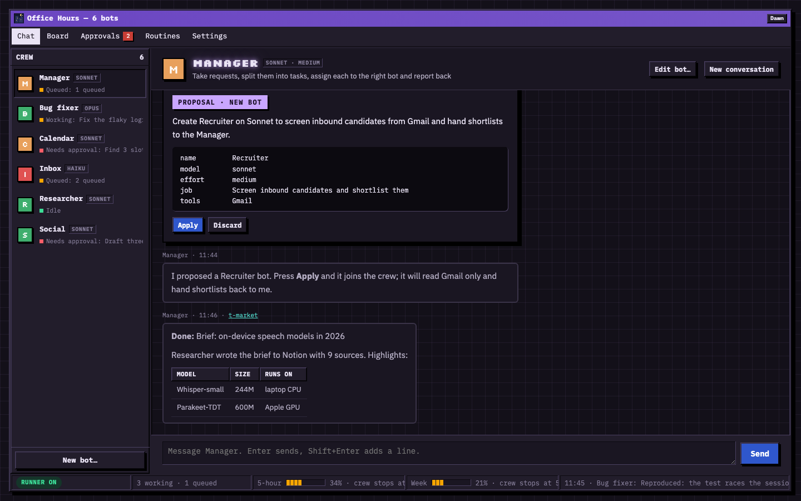
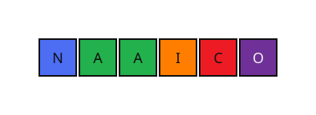

<p align="center"></p>

<h1 align="center">Office Hours</h1>

<p align="center"><b>A crew of Claude bots that works alongside you while your machine is on.</b><br>By <a href="https://naaico.com">NAAICO</a></p>

<p align="center">Office Hours is a crew of AI teammates for <a href="https://docs.claude.com/en/docs/claude-code">Claude Code</a>. You design each bot (its job, model, effort and connectors) and talk to it in a chat. Bots hand work to each other through a Manager and ask before they touch anything outside your machine. A runner on your Mac does the work, so it keeps going when Claude Code is closed, for as long as your machine is on and the runner is running.</p>



## What it does

- **Bots you design.** Give each one a job, a model (Opus, Sonnet, Haiku, Fable), an effort level (medium by default) and only the connectors it needs. Connectors are listed live from your Claude account.
- **Chat with any bot.** Ask the Manager for crew changes in plain words ("make a Recruiter bot on Sonnet that screens candidates from Gmail"). It proposes the change and nothing happens until you press **Apply**. Replies render Markdown.
- **Work moves through the Manager.** A bot that needs help hands the task to the Manager, which assigns it on. When the work is done it goes back up the chain to whoever asked, and the final answer lands as a reply in your chat.
- **You approve what matters.** Reads run on their own. Sending, posting, inviting, deleting, and any other change to a connected account waits for **Allow once**, **Always allow** or **Deny**.
- **It respects your plan.** The crew reads your plan's 5-hour and weekly usage from Claude Code itself. It stops starting work at the limits you set (50% of each by default), stops a run that crosses one, and carries on after the reset, so the rest stays yours.
- **Routines.** "Weekdays at 08:30, send me a morning brief", at most every 15 minutes.
- **Three ways in:** the browser app, `@Bot` mentions and `/bot` commands inside Claude Code, and a Bots pane in Claude Code.

| Board | Approvals |
|---|---|
|  |  |
| **New bot** | **Usage limits** |
|  |  |

The app follows your system's light or dark setting (Dawn and Neon), and the NAAICO mark greets you while it connects.

| Neon | Loading |
|---|---|
|  |  |

## How it works

```
 Browser app ──┐                                ┌── Plan windows (5-hour, weekly)
 Claude Code ──┼──▶  ~/.claude/bots  ◀──▶  Runner ──▶ claude -p as the bot ──▶ your connectors
 (mod, /bot)   ┘    bots · tasks · chats      │        (its model, effort,
                    approvals · routines      │         only its connectors)
                                              └── crew tools: handoff, assign, complete,
                                                  approvals (an MCP server per run)
```

| Part | Where | Job |
|---|---|---|
| Crew store | `~/.claude/bots/` (owner-only) | Bots as Markdown files, tasks with full history, chats, approvals, routines, the latest plan reading |
| Runner | `runner/main.ts` | Every 3 seconds: checks your usage limits, starts queued tasks and chat replies as their bot, sends results back up the chain, fires routines |
| Bot runs | `claude -p` | The official Claude Code CLI, signed in as you, with the bot's model and effort and only its own connectors |
| Crew tools | `runner/mcp.ts` | `handoff`, `assign_task`, `complete_task`, `block_task`, `remember`, `create_task`, `propose_change`, and the approval check every tool call goes through |
| Browser app | `runner/web/` · `http://127.0.0.1:4545` | Chat, bot builder, board, approvals, routines, settings |
| Claude Code mod | `mod/office-hours/` | `/bot` commands, `@Bot` mentions, the Bots pane, and Claude Code's own usage readings |

## Get started

You need **Node 24+** and **Claude Code**, signed in (`claude auth login`).

```bash
git clone https://github.com/naaico-tech/office-hours.git
cd office-hours
npm run seed      # creates ~/.claude/bots with Manager, Inbox, Calendar and Bug fixer
npm run runner    # starts the runner; it prints the browser app link
```

Open the printed link (`http://127.0.0.1:4545/?token=…`). It signs you in once with a cookie. Keep the runner running in a terminal for as long as you want the crew to work.

To use the crew from Claude Code as well, load the mod:

```bash
claude --plugin-dir ./mod/office-hours
```

Then `/bot web` prints the browser link and `/bot help` lists the commands.

## Examples

**Ask the Manager for a new bot** (browser app, Manager chat):

> Make a Recruiter bot on Sonnet that screens candidates from Gmail and hands them to you.

The Manager answers with a **Proposal · New bot** card showing the name, model, effort, job and connectors. Press **Apply** and the bot joins the crew.

**Give a bot work from Claude Code:**

```text
@Inbox triage this morning's email and draft replies
@Bug fixer[opus] the auth tests in web-app fail; fix them and open a PR
/bot assign plan the Acme renewal           (no bot named: the Manager takes it)
```

**A handover, start to finish.** You ask Inbox to "sort out the Acme call". Inbox needs a meeting booked, so it hands the task to the Manager with a note, and the Manager hands it to Calendar. Calendar wants to send an invite, so an approval appears and you press **Allow once**. Calendar finishes, and the task returns to the Manager, then to Inbox, which replies in the Acme thread. The answer appears in your chat with Inbox:

> **Done:** Sort out the Acme call
>
> **Booked** Tue 10:00 and replied in the Acme thread.

**More commands:**

```text
/bot new Recruiter | sonnet | Screen inbound candidates | Gmail | manager
/bot model Inbox sonnet
/bot routine add Calendar | weekdays 08:30 | Morning brief | Summarize today's meetings and flag conflicts
/bot teach Inbox | daily 17:30 | End-of-day sweep       turns the current conversation into a routine
/bot approve <id> always      /bot deny <id>      /bot reply <task> <answer>
```

**A bot is a Markdown file** in `~/.claude/bots/bots/`:

```markdown
---
name: Bug fixer
description: Fix failing tests in my repos and open PRs
model: opus
effort: high
connectors: Code, Atlassian
can_hand_to:
workdir: ~/code
---
Work in a new branch, run the tests before and after your change, and open a PR with gh. Never push to main.
```

## Usage, approvals and safety

- **One account, the official CLI.** Every model call is `claude -p`, the documented way to script Claude Code. The app never reads, copies or forwards your sign-in token. Bot runs count toward your Claude plan like your own use does, which is why the usage limits exist.
- **Usage limits** (Settings › Usage limits):
  - The crew stops at a share of your 5-hour and weekly windows.
  - One task may use only a set share of the 5-hour window.
  - A small runaway guard stops any single run that grows unexpectedly.
  - Bots run at medium effort unless you choose otherwise.
- **Approvals.** Reads run without asking. Sends, posts, deletes, invites and payments always ask, and so does any other change to a connected account. Everything else (editing files, running commands) goes to a quick review that asks you when unsure. "Always allow" saves a rule for one bot only.
- **Private by default.** The browser app listens on `127.0.0.1` only and needs the token link once. Writes need an `X-Bots` header, the Host header is checked, and the page loads no remote scripts or fonts. The crew store is readable by your user only.
- **Keep it personal.** Don't share the app or run it as a service for others on a personal plan. For heavier or business use, run the runner with an Anthropic API key.

## Development

```bash
npm test          # runner, crew tools, browser app and Markdown (node --test)
claude plugin validate mod/office-hours && claude plugin test mod/office-hours
```

The tests drive the real runner and crew tools against a stand-in `claude`, so they need no account and cost nothing.

## License

MIT, © NAAICO. The bundled fonts (Silkscreen, IBM Plex) are under the SIL Open Font License; see `runner/web/fonts/`.

<p align="center"><a href="https://naaico.com"></a></p>
